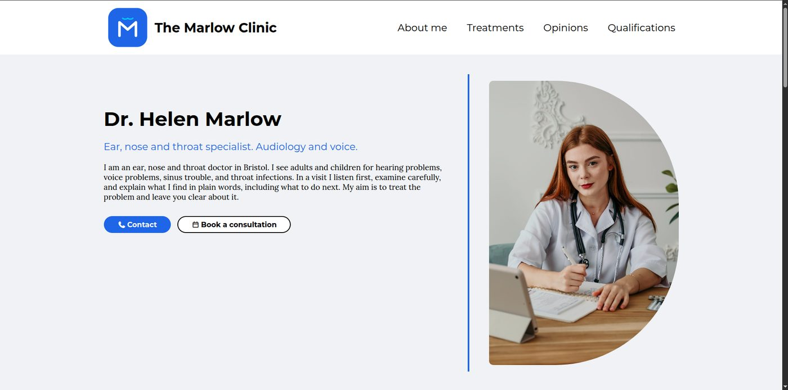

# The Marlow Clinic

A one-page site for a fictional clinic in Bristol. Built as a portfolio project: layout, responsive CSS, and a small amount of JavaScript. No build step. Open `index.html` in a browser.

**Live site:** https://kewinbielik.github.io/js-journey/Project1-DoctorWebsite/

## Features

- Four sections: about the doctor, treatments, patient reviews, and qualifications.
- Sticky top bar.
- Back-to-top button.
- When the browser asks for less motion, the automatic movement stops.
- The layout changes with the screen width:
    - The top bar menu switches to "hamburger".
    - Each section changes design to better fit the screen.
    - On a wide screen the reviews scroll on their own. Below 760px, buttons move one card at a time.

## Image credits

Pexels and Unsplash do not require a credit. These lines keep the source of each photo easy to find.

- `aboutMe.jpg`, the portrait in the about section. Photo by [Tima Miroshnichenko](https://www.pexels.com/photo/female-doctor-holding-a-pen-5407222/) on Pexels.
- `aboutMeBg.jpg`, the about-section background on smaller screens. Photo on [Pexels](https://www.pexels.com/photo/red-haired-woman-writing-5407219/).
- `qualiBg.jpg`, the qualifications photo. Photo on [Unsplash](https://unsplash.com/photos/green-potted-plant-on-white-ceramic-floor-tiles-HuWm7malJ18).
- `logo.svg`, the site logo. An original monogram made for this project.

Fonts are [Montserrat](https://fonts.google.com/specimen/Montserrat) and [Lora](https://fonts.google.com/specimen/Lora) from Google Fonts. Icons are from [Font Awesome](https://fontawesome.com/).
